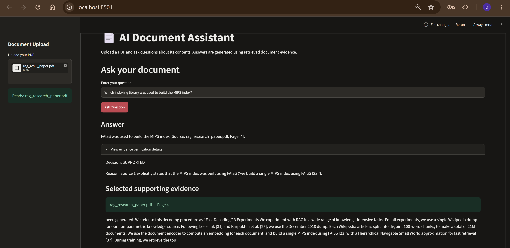
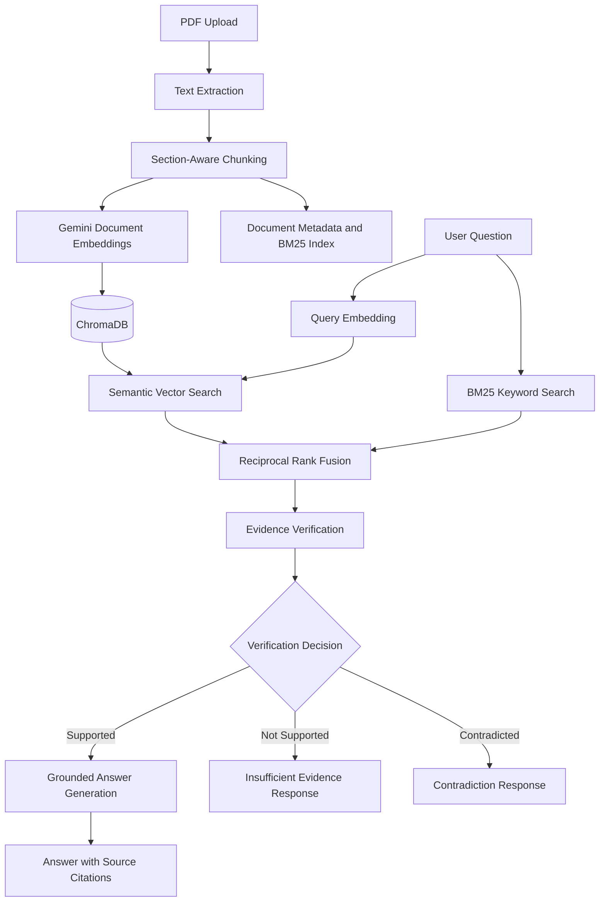

# AI Document Assistant
### Evidence-Grounded Question Answering with Hybrid Retrieval-Augmented Generation

An AI-powered document assistant that converts PDF documents into searchable knowledge sources. It combines semantic search, BM25 keyword retrieval, evidence verification, and grounded answer generation to answer questions with document and page-level references.

<p align="center">
  <a href="https://eey3vzlmnb3chwiva7lwdh.streamlit.app/">
    <strong>Live Demo</strong>
  </a>
  &nbsp; | &nbsp;
  <a href="https://github.com/Dhanalakshmi-S645/AI-Document-Assistant">
    <strong>GitHub Repository</strong>
  </a>
</p>

<p align="center">
  
  
  
  
  
</p>

---

## Application Preview

Upload PDF documents, ask questions in natural language, and inspect the evidence used to generate each answer.



**Live application:** https://eey3vzlmnb3chwiva7lwdh.streamlit.app/

## Problem Statement

Traditional document search often depends on manually locating keywords or reading lengthy documents. Basic RAG applications can also generate answers that are not adequately supported by retrieved content.

This project explores a more evidence-conscious approach by combining:

- Semantic retrieval for conceptual similarity.
- BM25 retrieval for exact keywords and technical terminology.
- Reciprocal Rank Fusion (RRF) for combining retrieval rankings.
- Evidence verification before answer generation.
- Source attribution using document filenames and page numbers.

## Key Features

| Feature | Implementation |
|---|---|
| PDF ingestion | Text extraction using PyPDF |
| Document chunking | Recursive text splitting with section metadata |
| Semantic retrieval | Gemini embeddings and ChromaDB |
| Keyword retrieval | BM25 using rank-bm25 |
| Hybrid retrieval | Reciprocal Rank Fusion |
| Retrieval fallback | BM25 when vector retrieval is unavailable |
| Evidence verification | Gemini-based support and contradiction assessment |
| Answer generation | Gemini with retrieved evidence as context |
| Source attribution | Filename and page-level citations |
| Duplicate detection | SHA-256 content hashing |
| Interactive interface | Streamlit |
| Multi-document search | Retrieval across indexed PDF documents |

## System Architecture



### Retrieval and Generation Pipeline

**1. Document ingestion**

- Accept PDF documents through the Streamlit interface.
- Extract text and page information using PyPDF.
- Split extracted text into manageable chunks.
- Preserve document metadata, including filename and page number.
- Generate embeddings and store chunks in ChromaDB.
- Detect identical documents using content hashing.

**2. Hybrid retrieval**

- Generate query embeddings using Gemini.
- Retrieve semantically relevant chunks from ChromaDB.
- Perform keyword-based retrieval using BM25.
- Combine the rankings using Reciprocal Rank Fusion.
- Apply result diversification to reduce repeated chunks from the same document.
- Use BM25 retrieval as a fallback when vector retrieval is unavailable.

**3. Evidence verification**

The retrieved passages are evaluated before answer generation.

The verification stage classifies evidence into three outcomes:

| Decision | Meaning |
|---|---|
| `SUPPORTED` | Retrieved evidence supports the requested information |
| `NOT_SUPPORTED` | The documents do not establish the requested information |
| `CONTRADICTED` | Retrieved evidence explicitly conflicts with the claim |

The verification response also contains a reason and references to the relevant evidence passages.

**4. Grounded answer generation**

- Generate answers only when evidence is classified as supported.
- Pass verified evidence to the generation model.
- Restrict answers to the supplied document content.
- Include source filename and page references.
- Return an insufficient-evidence response when support is unavailable.

## Technology Stack

| Technology | Purpose |
|---|---|
| Python | Core application logic |
| Streamlit | Web application interface |
| Google Gemini API | Embeddings, evidence verification, and answer generation |
| ChromaDB | Vector database |
| rank-bm25 | Keyword-based retrieval |
| PyPDF | PDF text extraction |
| LangChain Text Splitters | Document chunking |
| python-dotenv | Environment variable management |

## Project Structure

```text
AI-Document-Assistant/
│
├── app.py
├── requirements.txt
├── README.md
├── .gitignore
│
├── src/
│   ├── ingestion.py
│   ├── embeddings.py
│   ├── vector_store.py
│   ├── store.py
│   ├── retrieval.py
│   ├── keyword_retrieval.py
│   ├── answerability.py
│   └── generation.py
│
├── screenshots/
│   └── ai-document-assistant-demo.png
│
├── documents/
├── chroma_db/
│
└── evaluation and test scripts
```

## Getting Started

### Prerequisites

- Python 3.13 or a compatible Python version
- Google Gemini API key
- Git

### 1. Clone the repository

```bash
git clone https://github.com/Dhanalakshmi-S645/AI-Document-Assistant.git

cd AI-Document-Assistant
```

### 2. Create a virtual environment

```bash
python -m venv venv
```

Activate it on Windows:

```powershell
.\venv\Scripts\Activate.ps1
```

### 3. Install dependencies

```bash
python -m pip install -r requirements.txt
```

### 4. Configure environment variables

Create a `.env` file in the project root:

```env
GEMINI_API_KEY=your_gemini_api_key
```

Obtain an API key from [Google AI Studio](https://aistudio.google.com/).

**Security:** Never commit API keys, credentials, or private documents to GitHub.

### 5. Run the application

```bash
streamlit run app.py
```

Open the local URL displayed in your terminal.

## Evaluation and Testing

The project includes separate scripts for evaluating and testing different stages of the RAG pipeline.

| Evaluation Area | Objective |
|---|---|
| Document ingestion | Verify PDF extraction and chunking |
| Embeddings | Check document and query embedding generation |
| Retrieval | Examine relevance and ranking of retrieved passages |
| Hybrid retrieval | Evaluate the combination of vector and BM25 results |
| Answerability | Examine supported, unsupported, and contradicted outcomes |
| Generation | Evaluate evidence-grounded responses |

Functional checks have covered:

- Questions with directly supported answers.
- Questions whose answers are absent from the documents.
- Claims that contradict retrieved evidence.
- Retrieval across multiple uploaded documents.
- BM25 fallback when vector retrieval is unavailable.
- Source filename and page attribution.

These checks are development-stage validation, not a claim of production-level accuracy or generalizable performance.

## Engineering Decisions

**Why hybrid retrieval?**

Semantic search can identify conceptually related passages, while BM25 is useful for exact keywords, technical terms, and named entities. Combining both improves retrieval coverage.

**Why Reciprocal Rank Fusion?**

Vector similarity scores and BM25 scores are not directly comparable. RRF combines ranked results without requiring their raw scores to share the same scale.

**Why verify evidence before generation?**

A language model can produce plausible answers even when the retrieved context does not support them. An explicit verification stage introduces an additional check before generation.

**Why page-level citations?**

Source attribution makes it easier for users to inspect the original document and validate generated answers.

**Why modular architecture?**

Separating ingestion, embeddings, storage, retrieval, verification, and generation makes individual components easier to maintain and evaluate.

## Current Limitations

- The application currently supports PDF documents.
- Semantic retrieval depends on Gemini embedding API availability and quota limits.
- BM25 fallback provides keyword retrieval when vector search is unavailable, but does not replace semantic retrieval.
- The deployed application uses local ChromaDB storage, which may not persist across hosting restarts or redeployments.
- The application is a portfolio-stage implementation and has not been validated for production-scale concurrent users.
- Answer quality depends on PDF text extraction, retrieval relevance, and the quality of the underlying language model.

## Future Improvements

- Persistent cloud-based document and vector storage.
- More extensive retrieval and answer-quality evaluation datasets.
- Advanced reranking strategies.
- Improved document processing for tables and complex layouts.
- Authentication and user-specific document collections.
- Scalability and multi-user support.

## Author

**Dhanalakshmi S**

Information Science and Engineering Graduate | Aspiring AI/ML Engineer

- [GitHub Profile](https://github.com/Dhanalakshmi-S645)
- [LinkedIn](https://www.linkedin.com/in/dhanalakshmi-s-a54b892b/)

---

<p align="center">
  <strong>Exploring reliable, evidence-grounded AI systems through practical engineering.</strong>
</p>