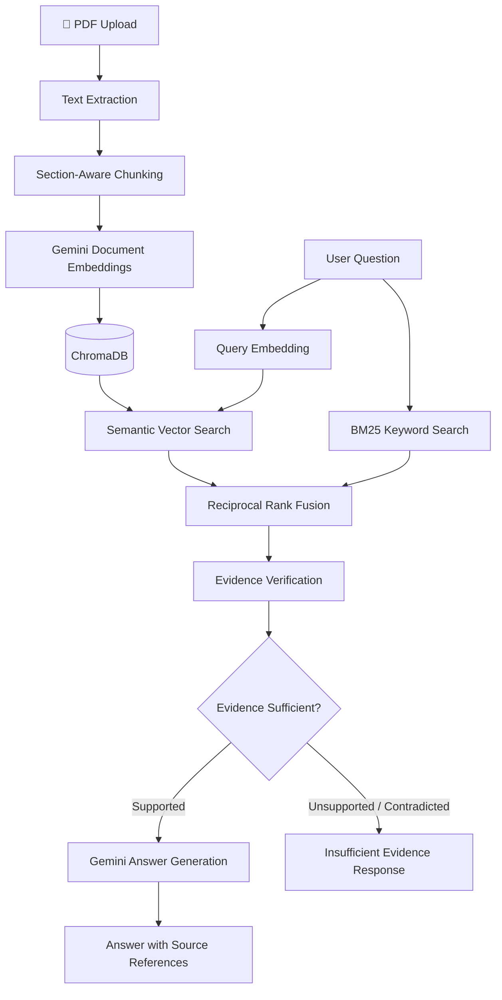

# 📄 AI Document Assistant
### Evidence-Grounded Question Answering with Hybrid Retrieval-Augmented Generation

<p align="center">
  A document intelligence application that transforms static PDFs into searchable knowledge sources using hybrid retrieval, evidence verification, and Generative AI.
</p>

<p align="center">
  
  
  
  
  
</p>

---

## Overview

## 🖥️ Application Preview

The application provides an interactive interface for uploading PDF documents, asking natural-language questions, and inspecting the evidence behind generated answers.


**Example:** The system identifies FAISS as the indexing library used for the MIPS index, verifies the retrieved passage as `SUPPORTED`, and provides the original document and page reference.
---

## ✨ Key Capabilities

| Capability | Implementation |
|---|---|
| PDF Processing | Text extraction and section-aware chunking |
| Semantic Search | Gemini embeddings with ChromaDB |
| Keyword Search | BM25 lexical retrieval |
| Hybrid Retrieval | Reciprocal Rank Fusion (RRF) |
| Evidence Verification | Gemini-based support and contradiction checks |
| Grounded Generation | Answer generation conditioned on verified evidence |
| Source Attribution | Document filename and page references |
| Interactive UI | Streamlit |

## 🏗️ System Architecture

The application follows a modular RAG pipeline with separate ingestion, retrieval, verification, and generation stages.



### Retrieval and Generation Workflow

**1. Document ingestion**

- Extract text from uploaded PDF files.
- Split content into manageable, section-aware chunks.
- Generate embeddings using Google's Gemini embedding model.
- Store document chunks, embeddings, and metadata in ChromaDB.

**2. Hybrid retrieval**

- Perform semantic similarity search using vector embeddings.
- Perform keyword retrieval using BM25.
- Combine rankings using Reciprocal Rank Fusion.
- Retrieve relevant passages for evidence evaluation.

**3. Evidence verification**

- Evaluate whether retrieved passages support the question.
- Identify supported, unsupported, and contradicted claims.
- Validate evidence references before passing them to generation.

**4. Grounded answer generation**

- Generate an answer only when sufficient supporting evidence is identified.
- Include source document and page references.
- Return an insufficient-evidence response when support is unavailable.

---

## 🧰 Technology Stack

| Technology | Role |
|---|---|
| Python | Core application logic |
| Streamlit | Interactive application interface |
| Google Gemini API | Embeddings, evidence verification and answer generation |
| ChromaDB | Persistent vector storage |
| rank-bm25 | Keyword-based retrieval |
| PyPDF | PDF text extraction |
| LangChain Text Splitters | Document chunking |

## 📁 Project Structure

```text
AI-Document-Assistant/
│
├── app.py
├── requirements.txt
├── .gitignore
│
├── src/
│   ├── ingestion.py
│   ├── embeddings.py
│   ├── vector_store.py
│   ├── store.py
│   ├── retrieval.py
│   ├── keyword_retrieval.py
│   ├── answerability.py
│   └── generation.py
│
├── test_answerability_evaluation.py
├── test_generation_evaluation.py
├── test_hybrid_retrieval.py
└── test_retrieval_evaluation.py
```

The application is organized into modular components to separate document processing, retrieval, verification, and generation.

## 🚀 Getting Started

### Prerequisites

- Python 3.13
- Google Gemini API key
- Git

### 1. Clone the repository

```bash
git clone https://github.com/Dhanalakshmi-S645/AI-Document-Assistant.git

cd AI-Document-Assistant
```

### 2. Create a virtual environment

```bash
python -m venv venv
```

Activate on Windows:

```powershell
.\venv\Scripts\Activate.ps1
```

### 3. Install dependencies

```bash
python -m pip install -r requirements.txt
```

### 4. Configure API credentials

Create a `.env` file in the project root:

```env
GEMINI_API_KEY=your_gemini_api_key
```

Get your API key from [Google AI Studio](https://aistudio.google.com/).

**Security:** Never commit API keys, credentials, or private documents to GitHub.

### 5. Launch the application

```bash
streamlit run app.py
```

Open the local URL provided by Streamlit in your browser.

---

## 🧪 Evaluation and Testing

The project includes dedicated evaluation scripts for examining different stages of the RAG pipeline.

| Evaluation | Focus |
|---|---|
| Retrieval Evaluation | Relevance and ranking of retrieved passages |
| Hybrid Retrieval Testing | Combination of semantic and lexical retrieval |
| Answerability Evaluation | Whether retrieved evidence supports a question |
| Generation Evaluation | Behaviour of grounded answer generation |

Evaluation is performed using manually labelled development questions and test cases.

Results from small development datasets are useful for debugging and comparing implementation choices, but should not be interpreted as production-level accuracy or generalizable performance guarantees.

---

## 🔍 Engineering Decisions

Some important design decisions in this project:

- **Hybrid instead of vector-only retrieval:** Semantic search captures conceptual similarity, while BM25 helps retrieve exact terms and technical keywords.
- **Reciprocal Rank Fusion:** Combines independently ranked retrieval results without requiring their raw scores to be directly comparable.
- **Evidence verification before generation:** Introduces an explicit validation stage to reduce unsupported answers.
- **Source attribution:** Connects generated responses to the original document and page.
- **Modular architecture:** Keeps ingestion, retrieval, verification, and generation independently maintainable and testable.

## 🛣️ Future Development

- Deploy a publicly accessible application.
- Introduce persistent cloud-based document storage.
- Expand retrieval evaluation datasets.
- Investigate advanced reranking strategies.
- Support multi-document question answering.
- Improve scalability and multi-user support.

## 👩‍💻 Author

**Dhanalakshmi S**

Information Science and Engineering Graduate | Aspiring AI/ML Engineer

[GitHub Profile](https://github.com/Dhanalakshmi-S645)

---

<p align="center">
  <b>Built to explore reliable, evidence-grounded AI systems.</b>
</p>